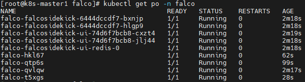
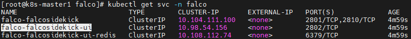
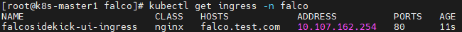
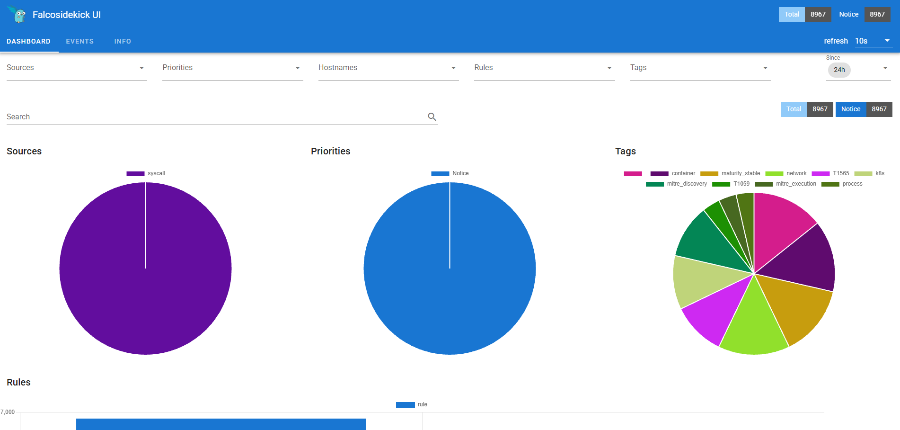

## 1. Falco 설치하기 :
### 1.1 Falco란? :

- Kubernetes와 Linux 서버에서 발생하는 비정상적인 행위를 실시간으로 감지하는 오픈소스 런타임 보안 도구이며, 기본적으로 이상 행위를 탐지하고 경고하는 도구이며, 자동으로 Pod를 차단하거나 삭제하지는 않습니다.

---

### 1.2 설치 전 환경 확인하기 :

- Falco를 설치하기 전, Kubernetes 클러스터를 구성하는 노드의 운영체제(OS), 커널 버전(Kernel Version), 컨테이너 런타임(Container Runtime)을 확인합니다.

```bash
$ kubectl get nodes \
  -o custom-columns='NAME:.metadata.name,KERNEL:.status.nodeInfo.kernelVersion,OS:.status.nodeInfo.osImage,RUNTIME:.status.nodeInfo.containerRuntimeVersion'
```

> Falco의 Modern eBPF 드라이버가 현재 노드 환경에서 정상적으로 동작할 수 있는지 확인하기 위함입니다.
{: .prompt-info}

---

### 1.3 Falco Helm Chart 다운로드 :

```bash
$ helm repo add falcosecurity https://falcosecurity.github.io/charts
$ helm repo update
$ helm search repo falcosecurity/falco --versions
```


* * *

- 폐쇄망에서 진행하는 경우 아래와 같이 진행하면 됩니다.

```bash
# 압축 파일 다운로드
$ helm pull falcosecurity/falco --version 9.2.2

# 압축 파일 풀기
$ tar -zxvf falco-9.2.2.tgz
```

* * *

### 1.4 FALCO Container Image 다운로드 : 

```bash
$ docker pull docker.io/falcosecurity/falco:0.45.2
$ docker pull docker.io/falcosecurity/falcoctl:0.14.3
$ docker pull docker.io/falcosecurity/falco-driver-loader:0.45.2

$ docker tag docker.io/falcosecurity/falco:0.45.2                harbor.inno.com/falcosecurity/falco:0.45.2
$ docker tag docker.io/falcosecurity/falcoctl:0.14.3             harbor.inno.com/falcosecurity/falcoctl:0.14.3
$ docker tag docker.io/falcosecurity/falco-driver-loader:0.45.2  harbor.inno.com/falcosecurity/falco-driver-loader:0.45.2

$ docker push harbor.inno.com/falcosecurity/falco-driver-loader:0.45.2
$ docker push harbor.inno.com/falcosecurity/falcoctl:0.14.3
$ docker push harbor.inno.com/falcosecurity/falco:0.45.2
```

* * *

### 1.5 values.yaml 수정하기 :

- 위 과정에서 다운받은 컨테이너 이미지로 수정 및 배포 관련 설정사항을 수정합니다.

```yaml
# falco/values.yaml
image:
  # -- The image pull policy.
  pullPolicy: IfNotPresent
  # -- The image registry to pull from.
  registry: harbor.test.com
  # -- The image repository to pull from
  repository: falcosecurity/falco
  # -- The image tag to pull. Overrides the image tag whose default is the chart appVersion.
  tag: ""

falco:
  json_output: true
  log_level: info

  stdout_output:
    enabled: true

  priority: debug

falcoctl:
  image:
    # -- The image pull policy.
    pullPolicy: IfNotPresent
    # -- The image registry to pull from.
    registry: harbor.test.com
    # -- The image repository to pull from.
    repository: falcosecurity/falcoctl
    # -- The image tag to pull.
    tag: "0.14.3"
  artifact:
    follow:
      enabled: false

driver:
  enabled: true
  kind: modern_ebpf
  loader:
    # -- Enable/disable the init container.
    enabled: true
    initContainer:
      image:
        # -- The image pull policy.
        pullPolicy: IfNotPresent
        # -- The image registry to pull from.
        registry: harbor.test.com
        # -- The image repository to pull from.
        repository: falcosecurity/falco-driver-loader
        #  -- Overrides the image tag whose default is the chart appVersion.
        tag: ""
```

* * *

### 1.4 Falco Helm Chart 설치하기 :

```bash
# 네임스페이스 생성
$ kubectl create namespace falco

# falco 설치 진행
$ helm upgrade --install falco ./ -n falco
```


* * *

- Helm Chart 설치 후, 파드 목록을 조회하여 정상 설치 되었는지 확인합니다.

```bash
# pod 목록 조회
$ kubectl get po -n falco
```


---

## 2. Falico UI 설정하기 :
### 2.1 Falcosidekick UI Container Image 다운로드 : 

```bash
$ docker pull docker.io/falcosecurity/falcosidekick:2.35.1

$ docker tag docker.io/falcosecurity/falcosidekick:2.35.1          harbor.test.com/falcosecurity/falcosidekick:2.35.1

$ docker push harbor.test.com/falcosecurity/falcosidekick:2.35.1
```

---

### 2.2 Falcosidekick UI 설치하기 :

- Falcosidekick UI를 설치하면 Falco가 탐지한 보안 이벤트를 웹 대시보드에서 실시간으로 확인할 수 있습니다.

```bash
# falco/values.yaml
falcosidekick:
  # -- Enable falcosidekick deployment.
  enabled: true
  image:
    # -- The Falcosidekick image tag to pull.i
    registry: harbor.test.com
    repository: falcosecurity/falcosidekick
    tag: "2.35.1"
  # -- Enable usage of full FQDN of falcosidekick service (useful when a Proxy is used).
  fullfqdn: false
  # -- Listen port. Default value: 2801
  listenPort: ""
  # 추가
  webui:
    enabled: true
    user: "admin:admin"
```
```bash
# falco/base 설치 진행
$ helm upgrade --install falco ./ -n falco
```

---

- Helm Chart 업데이트 후, 파드 목록을 조회하여 정상 설치 되었는지 확인합니다.

```bash
# pod 목록 조회
$ kubectl get po -n falco
```



---

### 2.3 Falcosidekick Ingress 생성하기 :

- 실제 생성된 Service 이름과 포트를 확인합니다.

```bash
$ kubectl get svc -n falco
```



---

- falcosidekick-ui-ingress.yaml 파일을 생성하여 적용합니다.

```bash
# 생성
$ vi falcosidekick-ui-ingress.yaml
```
```yaml
apiVersion: networking.k8s.io/v1
kind: Ingress
metadata:
  name: falcosidekick-ui-ingress
  namespace: falco
spec:
  ingressClassName: nginx
  rules:
    - host: falco.test.com
      http:
        paths:
          - path: /
            pathType: Prefix
            backend:
              service:
                name: falco-falcosidekick-ui
                port:
                  number: 2802
```
```bash
# 적용
$ kubectl apply -f falico-ui-ingress.yaml
```

---

- 적용 후, Ingress 설정 확인합니다.

```bash
$ kubectl get ingress -n falco
```



---

### 2.4 Falcosidekick UI 접속하기 :

- 위에서 생성한 Ingress 주소를 통해서 접속하여 로그인 진행합니다.




---